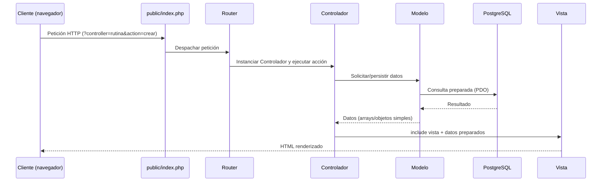

# Arquitectura del Proyecto

> Este documento define **cómo** está construido el sistema (patrón, estructura, flujo, diagramas técnicos).
> El **qué** (funcionalidad, actores, casos de uso) se define en `SPEC-CasosDeUso.md`.

## Contexto del proyecto

Proyecto académico (parcial). El foco de evaluación es la arquitectura — no el detalle visual de las vistas. Se pide sustentar el diseño con un **diagrama procedimental** (flujo de una petición); el modelo de datos se sustenta en `SPEC-DisenoConceptual.md`.

## Decisiones arquitectónicas

| Decisión | Elección | Motivo |
|---|---|---|
| Patrón | MVC moderno | La Vista no conoce al Modelo; solo recibe datos ya preparados por el Controlador. Separación estricta de responsabilidades. |
| Framework | Ninguno | PHP puro (vanilla). Requisito explícito del proyecto. |
| Autoload | `spl_autoload_register` manual | Carga automática de clases sin depender de Composer ni de ninguna herramienta externa. |
| Base de datos | PostgreSQL vía PDO (`pdo_pgsql`) | Acceso desacoplado del motor concreto; *prepared statements* para evitar inyección SQL. |
| Enrutamiento | Punto único de entrada (`public/index.php`) + router simple | Toda petición pasa por un front controller que despacha a Controlador/Acción según la URL. |
| Vistas | HTML plano + CSS mínimo | El detalle visual no es objeto de evaluación; las vistas solo renderizan datos recibidos. |

## Regla de oro del MVC moderno

```
Vista  ──X──  no conoce al Modelo (nunca lo instancia, nunca consulta la BD)
Vista  <──── recibe únicamente datos simples (arrays/escalares) desde el Controlador
Controlador ──> orquesta: recibe la petición, llama al Modelo, prepara datos, incluye la Vista
Modelo ──> encapsula el acceso a datos (PDO) y las reglas asociadas a una entidad
```

## Estructura de carpetas

```
/public
  index.php              # único punto de entrada (front controller)
  /assets
    /css

/app
  /Core
    Router.php           # interpreta la petición y despacha a Controlador::accion()
    Controller.php        # clase base abstracta (helpers comunes, ej. render())
    Model.php             # clase base abstracta (conexión PDO compartida)
  /Config
    Database.php          # construye y expone la conexión PDO a PostgreSQL
  /Controllers
    AuthController.php
    CategoriaController.php
    RutinaController.php
    EjercicioController.php
    VideoController.php
    PublicController.php  # consulta pública (sin login)
  /Models
    Instructor.php
    Categoria.php
    Rutina.php
    Ejercicio.php
    Video.php
  /Views
    /auth        (login.php)
    /categorias  (index.php, form.php)
    /rutinas     (index.php, form.php)
    /ejercicios  (index.php, form.php)
    /videos      (index.php, form.php)
    /public      (rutinas.php, rutina_detalle.php)
    /layout      (header.php, footer.php)
  autoload.php           # spl_autoload_register: mapea namespace App\* a /app/*

/database
  schema.sql             # DDL de PostgreSQL
```

## Diagrama procedimental (flujo de una petición)



**Enrutamiento**: se usa query string (`index.php?controller=rutina&action=crear`) por ser la opción más simple, sin requerir reglas de reescritura de URL en el servidor.

## Modelo de datos

El diseño conceptual del modelo de datos (entidades, atributos, relaciones y cardinalidades) vive en `SPEC-DisenoConceptual.md`, no en este documento.

## Correspondencia con casos de uso

Cada grupo de casos de uso de `SPEC-CasosDeUso.md` mapea 1 a 1 con un Controlador y su(s) Modelo(s):

| Grupo de casos de uso | Controlador | Modelo(s) |
|---|---|---|
| Acceso | `AuthController` | `Instructor` |
| Gestión de Categorías | `CategoriaController` | `Categoria` |
| Gestión de Rutinas | `RutinaController` | `Rutina` |
| Gestión de Ejercicios (catálogo) | `EjercicioController` | `Ejercicio` |
| Asignación Rutina↔Ejercicio (N a M) | `RutinaController` (acciones `asignarEjercicio`/`quitarEjercicio`) | `RutinaEjercicio` |
| Gestión de Videos | `VideoController` | `Video` |
| Consulta pública | `PublicController` | `Rutina`, `Ejercicio`, `RutinaEjercicio`, `Video` (solo lectura) |
