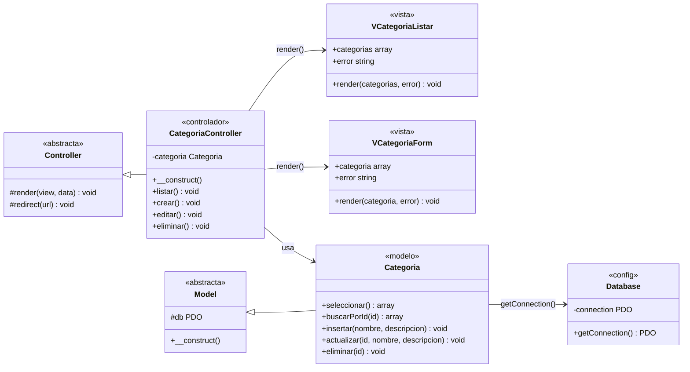
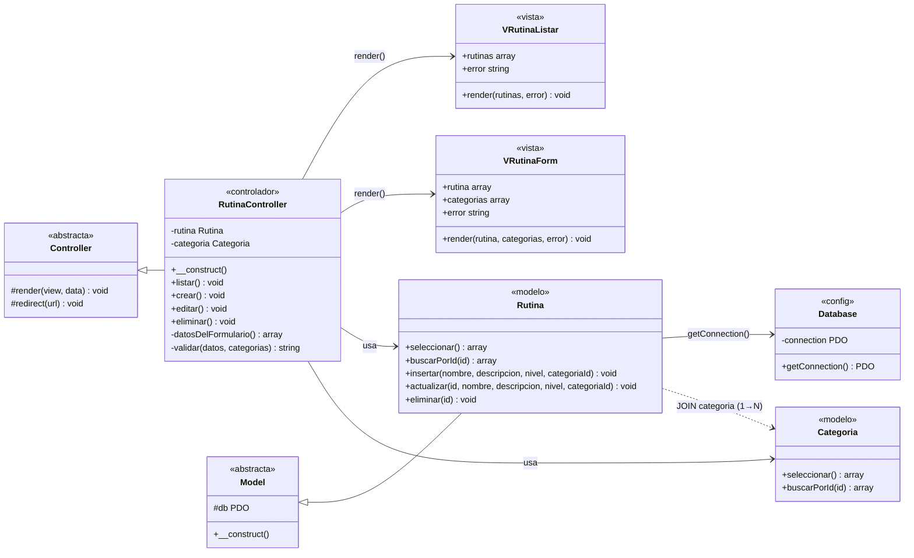

# Detalle Procedimental por Caso de Uso

> Complementa a `Arquitectura.md` (que define el diagrama procedimental genérico, de secuencia)
> con el diagrama de detalle **por caso de uso**: las clases realmente involucradas en cada capa
> (Vista/Controlador/Modelo), con sus atributos y métodos, al estilo de `ai/imagenes/DetalleDeEjemplo.png`.

## Convenciones de traducción (Swing → MVC web en PHP)

El ejemplo de referencia es una app de escritorio (Java/Swing), donde la Vista es una clase
(`JFrame`) con métodos propios. Acá la arquitectura es distinta en dos puntos, y el diagrama lo
refleja así:

- **Vista sin métodos reales**: `app/Views/**/*.php` son scripts planos, no clases. Se fuerzan
  como clase con estereotipo `«vista»` y un único método **simbólico** `render(...)` que representa
  "el Controlador incluye este archivo pasándole estas variables" — no existe tal método en el código.
- **Sin capa "Negocio" separada**: el Controlador absorbe esa responsabilidad (no hay `NCategoria`
  equivalente); por eso el Controlador llama directo al Modelo.
- `Config::Database` es el equivalente a `Dato::Conexion` del ejemplo.

## CU-02 | Gestionar categorías

## Correspondencia clase → archivo

| Clase (diagrama) | Archivo real |
|---|---|
| `VCategoriaListar` | `app/Views/categorias/index.php` |
| `VCategoriaForm` | `app/Views/categorias/form.php` |
| `Controller` | `app/Core/Controller.php` |
| `CategoriaController` | `app/Controllers/CategoriaController.php` |
| `Model` | `app/Core/Model.php` |
| `Categoria` | `app/Models/Categoria.php` |
| `Database` | `app/Config/Database.php` |

## CU-03 | Gestionar rutinas

Complejidad **Medio** (`categoria` 1→N `rutina`): la relación se atraviesa en dos puntos —
`Rutina::seleccionar()` hace el `JOIN` contra `categoria` para mostrar el nombre de la categoría
en el listado, y `RutinaController` depende también de `Categoria` (no solo de `Rutina`) para
poblar el `<select>` del formulario y validar que el `categoria_id` recibido exista.

## Correspondencia clase → archivo

| Clase (diagrama) | Archivo real |
|---|---|
| `VRutinaListar` | `app/Views/rutinas/index.php` |
| `VRutinaForm` | `app/Views/rutinas/form.php` |
| `Controller` | `app/Core/Controller.php` |
| `RutinaController` | `app/Controllers/RutinaController.php` |
| `Model` | `app/Core/Model.php` |
| `Rutina` | `app/Models/Rutina.php` |
| `Categoria` | `app/Models/Categoria.php` |
| `Database` | `app/Config/Database.php` |
